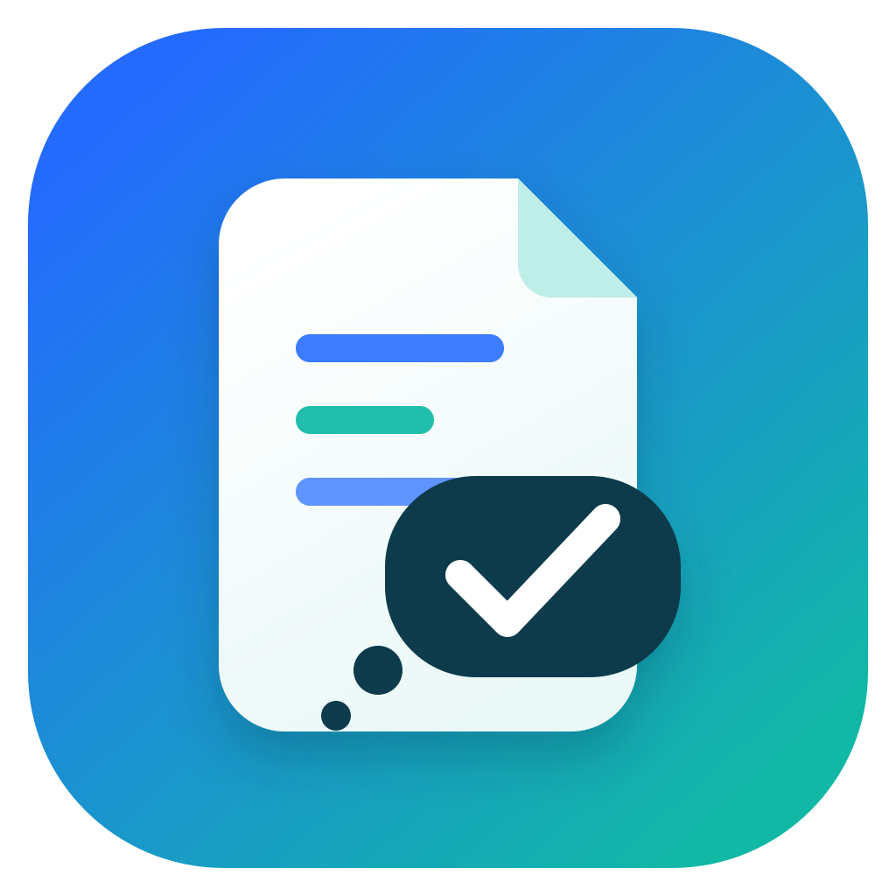

<div align="center">



**Thoughts for Android** is a fast, private, source-linked document workspace: read and review the PDFs of a Thoughts Library, with their comments, notes and review cards, synchronized with a Thoughts server.

By **Tommaso Bendinelli**. Built on [MJ PDF](https://gitlab.com/mudlej_android/mj_pdf_reader) by Mudlej, see [Acknowledgements](#acknowledgements).

[](LICENSE)
[](https://developer.android.com/about/versions/marshmallow)

</div>

## Features

**Library**
- Home screen with three tabs: Comments & Todo, Library, and Review.
- Continue reading right where you left off, with a detailed reading history.
- Reading statuses: to-read, reading, on-hold, completed, abandoned.
- Cover grid or list view, with adjustable grid size and sorting.
- The Review tab studies approved, source-anchored cards created in Thoughts on the desktop, either across the library or by PDF deck.
- Search every PDF on your device.
- Reading progress and statuses survive file moves and renames.

**Reader**
- Fast, simple, and very lightweight.
- Dark mode for the app and for the PDF itself.
- True full screen with configurable buttons, reading progress, time, and page info.
- Rotate, brightness bar, auto-scroll with adjustable speed, zoom lock, screenshots.
- Dual page mode that pairs pages like an open book.
- Hide PDF margins to make the page fill your screen.
- Right-to-left reading with automatic detection.
- Open password-protected PDFs and online PDFs through links.
- Share and print PDFs. Open multiple instances at the same time.
- Mouse wheel and mouse button support, volume-key page turning.

**Highlights, signatures, and forms**
- Highlight text and save the highlights into the PDF file.
- Attach notes to highlights, browse them in My Notes and My Highlights pages.
- Edit highlights that already exist in the document.
- Draw a handwritten signature once, reuse it anywhere, saved as sharp vector strokes.
- Fill PDF forms.
- Select text inline with copy, share, web-search, translate, and dictionary actions.
- Share quotes as images, with the book's name and a choice of themes.

**Search and navigation**
- Very fast and powerful search with live streaming results.
- Next and previous result navigation from inside the reader.
- A page for the full Table of Contents, with search.
- A page for all the links embedded in the PDF.
- User bookmarks with custom names and chapter context.
- Browser-like back and forward navigation history.

**Text Mode**
- Read any PDF like an e-book.
- Text reflow, multiple fonts, themes, and adjustable line length.

**Privacy**
- Open source with total privacy.
- No data collection, no ads, no tracking.
- Incognito mode that saves nothing about what you read.

## Permissions and privacy
The app collects no data and has no ads or tracking. It talks only to the Thoughts server you configure.
These permissions provide specific features:
* *Internet*: for Sync with your Thoughts server and for opening PDFs through links
* *Storage / all-files access*: for scanning, opening, and managing the PDFs on your device

The app has no location permission and uses no Google Maps, Places or Play services library: the place picker for comments was removed. A place that a comment got from an earlier version is kept with the comment and can only be removed.

The app includes ACRA, a crash reporter. It sends nothing unless you press SEND on the dialog that appears after a crash, and it needs an endpoint configured at build time; its configuration is [in the code](app/src/main/java/com/gitlab/mudlej/MjPdfReader/App.kt).

## Security notes

### Where the note sources are kept
The editable working copy of your note sources (LaTeX, Markdown) is kept in the app's private storage, where no other app can read or change it. *Settings → Synchronization → Keep sources in a shared folder* moves it to `Documents/Thoughts Sources` instead, for editing with other apps; every app with access to your files can then read and change the sources. An installation that used the shared folder before this setting existed keeps it until you switch.

In the shared folder, a change that was not made in Thoughts is never uploaded by itself. Sync leaves such a file alone and lists it in the Sync details ("source files changed outside Thoughts"), where you upload the change or discard it. Until you choose, a change you make to that file in Thoughts (an edit, or a comment or review card placed in it) is uploaded together with the outside change, because both are in the one file. Switching back to private storage is refused while such a change waits.

### Glasses camera link
*Send with picture* (agent notes) asks Mentra Live glasses for a photo through the camera server that runs on the glasses, at the address set under Settings → Glasses camera (port 8089). That link is plain HTTP on the local network: it is not encrypted and neither side proves who it is. The glasses only check the address of the device that asks (their gallery allowlist). Anyone on the same network can read the photos in transit, change them, or answer in the glasses' place, and a photo taken this way is then sent with the reply. Use it on a network you trust (your own hotspot or home network). Thoughts sends no token or other secret over this link, accepts only a JPEG up to the server's image limit, and follows no redirects.

### What the build downloads
`./gradlew` and the Python scripts under `build_dependencies/` fetch code that ends up in the APK. What is checked today, and what should be pinned before relying on a build from a fresh machine:

| Download | Today | Pin |
|---|---|---|
| Gradle distribution (`gradle/wrapper/gradle-wrapper.properties`) | pinned: `distributionSha256Sum` holds the SHA-256 Gradle publishes for 9.5.0 | set the new checksum whenever the version changes |
| Official universal APK for the native libraries (`bootstrap_release_libs.py`) | pinned and verified | — |
| PDFium prebuilt binaries (`PDFIUM_URLS` in `build_dependencies/values.py`) | release tag `chromium/7920`, no checksum | the SHA-256 of each of the four `.tgz` files, checked after download; a tag can be re-pointed |
| PDFium source and depot_tools (`PDFIUM_GIT_URL`, `DEPOT_TOOLS_GIT_URL`) | branch `chromium/7920`; depot_tools at its head | the commit of the branch and a commit of depot_tools |
| libpng and FreeType sources (`LIBPNG_URL`, `FREETYPE_URL`) | SourceForge "latest" | a fixed version URL and the SHA-256 of the archive (or the project's signature) |
| GitHub Actions (`.github/workflows/verify.yml`) | commits, except `actions/setup-java` | the commit of the release in use |

Archives are extracted with a check that no member leaves the target directory, and build commands run without a shell.

## How to build
Thoughts builds against the Kotlin SDK of a `thoughts-server` checkout next to this one (`../thoughts-server`, or `-PthoughtsClientDir=<path>`) and the committed patched PDFium:

```sh
python3 build_dependencies/install_patched_libs.py
./gradlew :app:assembleDebug :NoteShortcut:assembleDebug
./gradlew :app:testSandboxUnitTest
```

[AGENTS.md](AGENTS.md) has the build options (server address and the other deployment values), the unit and instrumentation test rules, and how to rebuild the native libraries.

- Native `.so` files are intentionally excluded from Git; `install_patched_libs.py` installs the committed patched PDFium for the four supported ABIs and rebuilds the JNI bridge.
- To set up a build environment from a fresh Linux install, see [SETUP.md](SETUP.md).
- To rebuild the native libraries (PDFium, FreeType, libpng, and the JNI bridge), use the scripts in [build_dependencies](build_dependencies/).
- After editing `mainJNILib.cpp`, go to `PdfiumAndroid/src/main/jni` and run `ndk-build`.

The repository has these modules:

| Module | Role |
|---|---|
| `app` | The Thoughts application |
| `NoteShortcut` | A small companion app that opens a new note in Thoughts |
| `AndroidPdfViewer` | The viewer library: rendering, gestures, text selection, highlights (MJ PDF's fork of AndroidPdfViewer) |
| `PdfiumAndroid` | Bindings to the PDFium engine (MJ PDF's fork of PdfiumAndroid) |

The Kotlin sources keep MJ PDF's namespace `com.gitlab.mudlej.MjPdfReader`, so that later MJ PDF releases stay easy to compare and merge.

## Contributing
Issues and pull requests are welcome on this repository. Translations live in `app/src/main/res/values-<lang>/strings.xml`.

## Acknowledgements
Thoughts for Android was originally built on top of [MJ PDF](https://gitlab.com/mudlej_android/mj_pdf_reader), the PDF reader by [Mudlej](https://mudlej.com), starting from its v3.0.0 release. We are very grateful to Mudlej, and to the people MJ PDF itself builds on and thanks:

- Gokul Swaminathan ([@JavaCafe01](https://github.com/JavaCafe01)), whose PDF Viewer Plus was the base of MJ PDF v1 and v2;
- Bartosz Schiller ([@barteksc](https://github.com/barteksc)), who wrote AndroidPdfViewer and PdfiumAndroid, the viewer and PDFium bindings this app's PDF stack grew from;
- [@Derekelkins](https://github.com/Derekelkins), [Bnyro](https://gitlab.com/Bnyro) and MJ PDF's community translators;
- the PDFium, FreeType, libpng, OpenJPEG and LLVM projects, whose libraries are bundled.

Their code keeps its copyright notices and licences: see [LICENSE](LICENSE), [OLD_LICENSE](OLD_LICENSE), the module licences and [THIRD-PARTY-NOTICES.md](THIRD-PARTY-NOTICES.md).

## License
Thoughts for Android is licensed under the GNU General Public License v3.0, like MJ PDF ([LICENSE](LICENSE)). The parts that come from PDF Viewer Plus were under the MIT license ([OLD_LICENSE](OLD_LICENSE)). The libraries the app bundles or downloads at build time are listed with their licences in [THIRD-PARTY-NOTICES.md](THIRD-PARTY-NOTICES.md); Google Play services, Maps and Places are no longer among them.

Copyright © 2026 Tommaso Bendinelli; copyright of the inherited code remains with its authors.
